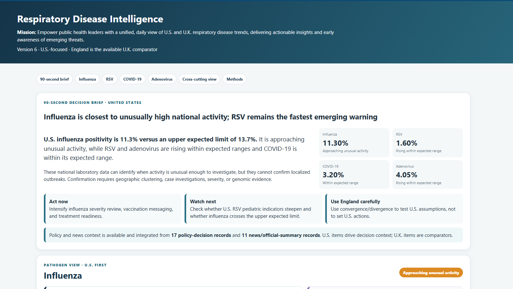
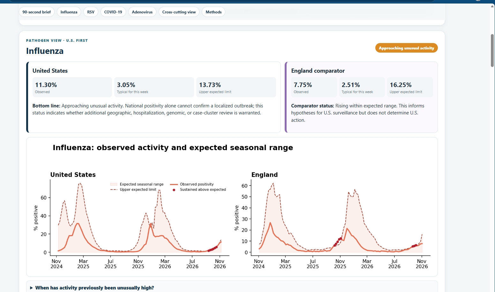
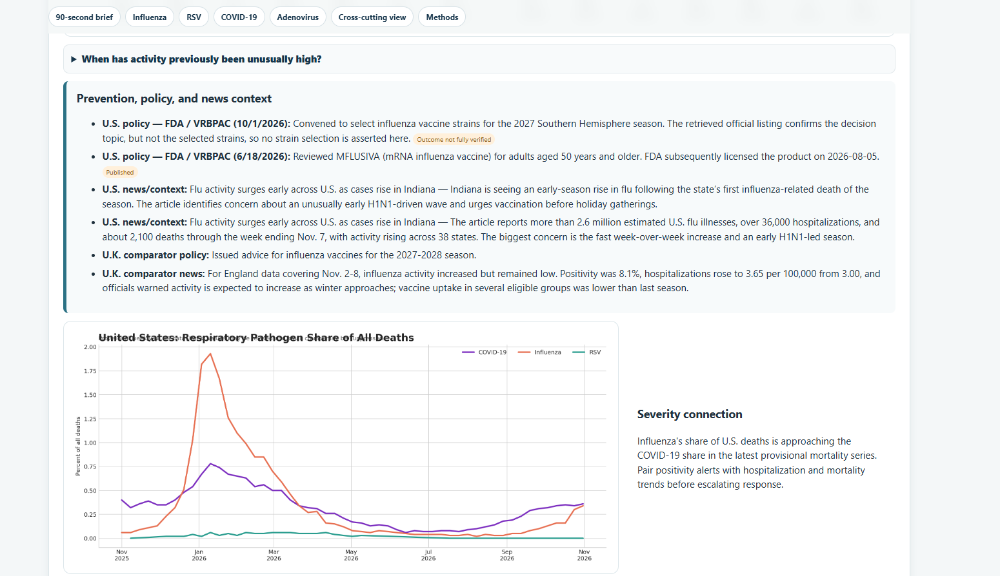
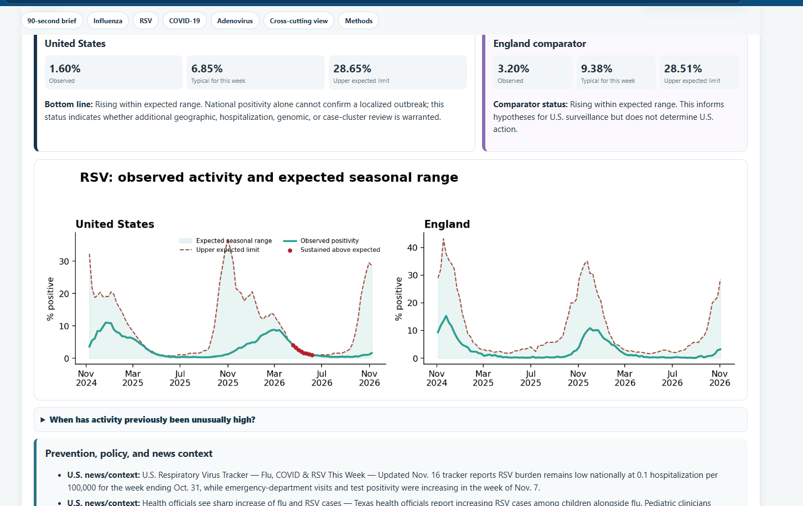
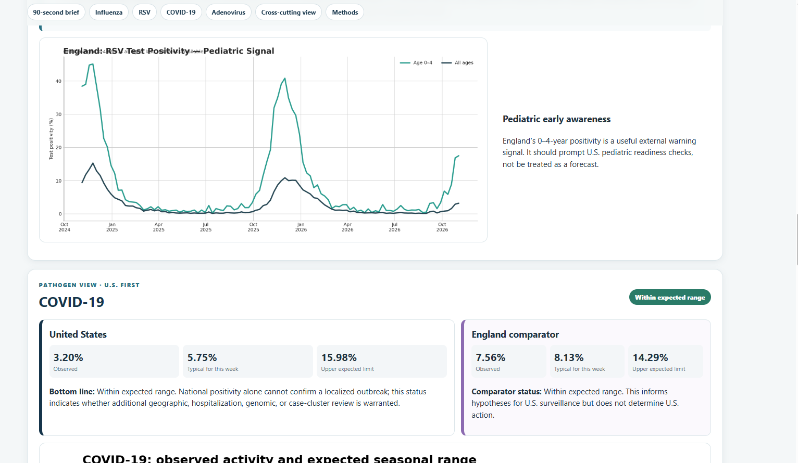

# Respiratory Disease Intelligence Dashboard

> Developed during the **November 16–18, 2026 Microsoft–CDC Buildathon**, with Microsoft engineers serving as technical coaches and advisors throughout the event.


---

## Public Data Notice

This project uses **only publicly available surveillance, laboratory, mortality, hospitalization, policy, and news data**.

No restricted, confidential, patient-level, proprietary, personally identifiable, or internal government data were used.

All datasets can be obtained directly from their respective public providers.

---

## Overview

## Dashboard Preview

### Executive Brief



### Influenza Intelligence View



### RSV Intelligence View



### Cross-Cutting Respiratory Assessment



### Policy and News Context



## The Problem

Public health leaders often receive information from multiple disconnected sources:

- Surveillance systems
- Laboratory reports
- Mortality data
- Policy updates
- News reports
- Research publications

The challenge is not a lack of information.

The challenge is answering:

1. **What changed?**
2. **What does it mean?**
3. **What is likely to happen next?**
4. **What should leadership be prepared to answer?**

This project explores how analytics and AI can help answer those questions more efficiently.

---

## Version 6.1 Enhancements

Version 6.1 builds upon the original dashboard by introducing an AI-assisted intelligence layer.

### Change Brief

Identifies meaningful changes since the previous reporting period.

### Signal-Convergence Assessment

Determines whether available surveillance indicators support a common respiratory disease narrative.

### Near-Term Outlook

Provides a trend-based assessment of what may occur over the next 2–6 weeks.

### Leadership Question Forecast

Anticipates the questions public health leaders may need to answer.

---

## Key Features

✅ Respiratory disease situational awareness

✅ NREVSS integration

✅ Influenza monitoring

✅ RSV monitoring

✅ COVID-19 monitoring

✅ Adenovirus monitoring

✅ Mortality context

✅ Hospitalization context

✅ Seasonal baseline calculations

✅ Statistical signal detection

✅ Historical activity analysis

✅ Policy integration

✅ News integration

✅ AI-assisted intelligence generation

✅ Leadership-focused decision support

---

## Dashboard Framework

The dashboard is organized around four intelligence products.

### 1. Change Brief

**Question Answered**

> What changed since the last reporting period?

---

### 2. Signal-Convergence Assessment

**Question Answered**

> What is the overall respiratory story, and how confident are we?

---

### 3. Near-Term Outlook

**Question Answered**

> What is likely to happen over the next 2–6 weeks?

---

### 4. Leadership Question Forecast

**Question Answered**

> What questions should leaders be prepared to answer?

---

## Statistical Methodology

### Typical for This Week

Historical median using the same ISO week with a ±2-week seasonal window.

### Upper Expected Limit

The larger of:

- Q3 + 1.5 × IQR
- Median + 3 × MAD × 1.4826

### Classification Categories

- Within Expected Range
- Rising Within Expected Range
- Approaching Unusual Activity
- One-Week Alert
- Potential Outbreak Signal

These classifications are statistical signals and **do not confirm outbreaks**.

---

## Data Sources

### United States

- CDC NREVSS
- CDC Test Positivity Data
- NHSN Hospitalization Data
- NCHS Mortality Data

### England Comparator

- UK Health Security Agency (UKHSA)

### Policy Sources

- ACIP
- FDA
- JCVI
- MHRA

### News Sources

- Publicly available public health news
- Official public health summaries

---

## Architecture

```text
Public Data Sources
        ↓
Data Ingestion
        ↓
Data Validation
        ↓
Seasonal Baselines
        ↓
Signal Detection
        ↓
Visualization Layer
        ↓
AI Intelligence Layer
        ↓
Leadership Dashboard
```

## Repository Structure

```text
respiratory-disease-intelligence-dashboard/
│
├── README.md
│
├── dashboard/
│   └── respiratory_disease_intelligence_dashboard_v6_1.html
│
├── docs/
│   ├── dashboard-home.png
│   ├── pathogen-view.png
│   ├── architecture-diagram.png
│   └── buildathon-summary.pdf
│
└── assets/
    └── microsoft-buildathon-badge.png
```

---

## Buildathon Collaboration

This project was developed during a three-day Buildathon held November 16–18, 2026, through collaboration between CDC and Microsoft.

The Buildathon brought together public health, analytics, and technology team members to explore how AI-assisted solutions can improve respiratory disease situational awareness using publicly available data.

Microsoft engineers provided technical coaching and guidance on:

- Architecture
- Data integration
- AI capabilities
- Prompt engineering
- Dashboard design
- Microsoft technology implementation

CDC participants contributed:

- Public health expertise
- Surveillance interpretation
- Requirements gathering
- Validation and testing
- User-centered design feedback

The project was presented during the final-day Buildathon showcase.

---

## Lessons Learned

One of the biggest takeaways was that the primary challenges were not related to analytics or AI.

The largest challenges involved:

- Access and permissions
- Data connectivity
- Firewall and network restrictions

Once those foundational requirements were addressed, development of analytics, visualizations, and AI-assisted capabilities progressed much more smoothly.

### Recommendation

Future Buildathons would benefit from:

- Early access provisioning
- Connectivity validation before kickoff
- Firewall reviews before development begins
- A high-level review of the Microsoft products and services that will be used

---

## Recognition

- Microsoft–CDC Buildathon Participant
- Microsoft Buildathon Badge Recipient *(pending issuance)*

Add the official badge image here when available.

---

## Responsible Use

- Treat generated narratives as decision-support content.
- Validate important findings against source data.
- Communicate uncertainty clearly.
- Do not infer localized outbreaks from national positivity data alone.
- Use England as contextual evidence, not as a policy driver.

---

## Disclaimer

This repository contains a proof-of-concept respiratory disease intelligence dashboard created for educational, demonstration, and situational-awareness purposes.

All datasets used in this project are publicly available.

No restricted, confidential, internal, patient-level, or personally identifiable information was used.

The analyses, visualizations, statistical classifications, and AI-assisted summaries do not constitute clinical guidance, policy recommendations, or official public health determinations.

Statistical signals displayed within the dashboard should not be interpreted as confirmation of outbreaks.

Confirmation requires additional evidence such as:

- Geographic clustering
- Clinical severity
- Hospitalization patterns
- Genomic linkage
- Epidemiologic investigation

Any interpretations or conclusions presented in this repository are those of the project contributors and do not represent official positions, policies, or endorsements of CDC, HHS, Microsoft, or any other organization.

---

## Data Availability

All datasets used in this project are publicly available from their respective source organizations.

No special access, clearance, or permissions are required to reproduce the analyses.

---

## Acknowledgments

Special thanks to all CDC participants, Microsoft engineers, coaches, reviewers, and collaborators who contributed to the project during the November 16–18, 2026 Microsoft–CDC Buildathon.
